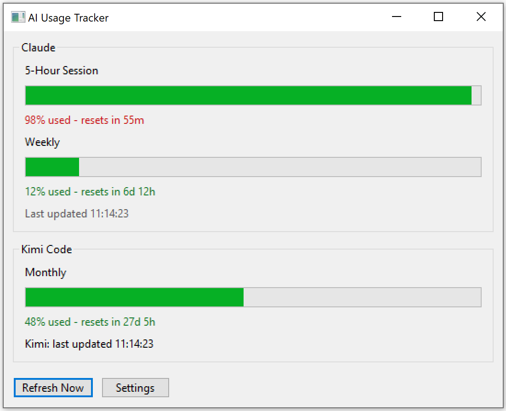
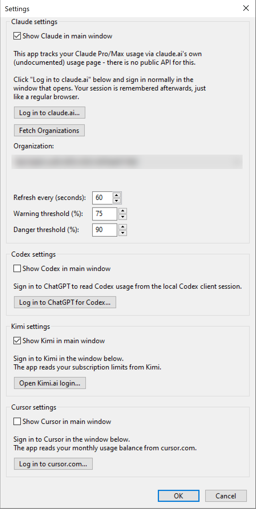
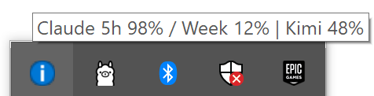

# AI Usage Tracker

A lightweight Windows tray app that tracks your usage limits for **Claude**, **Codex (ChatGPT)**, **Kimi**, and **Cursor** — without needing API keys. It reads usage directly from each provider's own web session, the same way your browser does.



## Features

- Tracks Claude Pro/Max 5-hour and weekly usage windows
- Tracks Codex (ChatGPT) monthly usage
- Tracks Kimi monthly usage
- Tracks Cursor monthly usage
- Lives in the system tray with periodic auto-refresh and an at-a-glance tooltip
- Sign in normally through an embedded browser session per provider — no credentials or API keys stored by the app

## Screenshots

| Settings | Tray |
|---|---|
|  |  |

## Usage

1. Launch `AiUsageTracker.exe`.
2. Open **Settings** and sign in to each provider you want to track through its login button.
3. The app polls each provider periodically and shows usage in the main window and tray tooltip.

Settings and logs are stored under `%APPDATA%\AiUsageTracker`.

## Building

Requires [vcpkg](https://github.com/microsoft/vcpkg) and CMake with an MSVC toolchain.

```bash
cmake -B build -S . -DCMAKE_TOOLCHAIN_FILE=<path-to-vcpkg>/scripts/buildsystems/vcpkg.cmake
cmake --build build --config Release
```

Dependencies (fetched automatically via vcpkg, see [vcpkg.json](vcpkg.json)):

- [wxWidgets](https://www.wxwidgets.org/) (core, base, webview)
- [nlohmann-json](https://github.com/nlohmann/json)

## License

[MIT](LICENSE)
